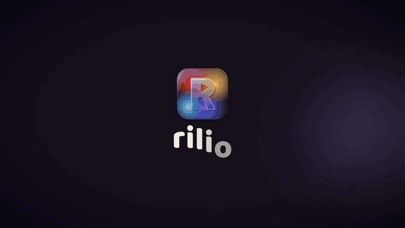

<div align="center">


# rilio

**قايمة مشاهدتك… اتعملت للسهرات الحلوة 🍿**

برنامج ويندوز وإضافة للمتصفح بيلمّوا كل الأفلام والمسلسلات اللي عايز تشوفها في مكان واحد.
تقدر تتفرج من جوه البرنامج، والحلقات بتتعلّم لوحدها، وكمان تتفرج مع صحابك وتاخد ترشيحات على ذوقك.

[](https://github.com/Gasser-hafez/Rilio/releases/latest)


### [⬇️ حمّل rilio لويندوز](https://github.com/Gasser-hafez/Rilio/releases/latest)

<a href="promo/rilio-promo.mp4"></a>

<sub>▶️ دوس على الصورة عشان تشوف <a href="promo/rilio-promo.mp4">الفيديو كامل بالصوت</a> (دقيقتين)</sub>

</div>

<div dir="rtl">

## المميزات

### 📋 قايمتك متنظمة
- **إضافة في ثانية:** اكتب اسم الفيلم أو المسلسل، والنتايج بتظهر وإنت بتكتب ومعاها البوستر والسنة وتقييم IMDb. ولو غلطت فيه زرار "تراجع".
- **من صفحة IMDb على طول:** إضافة المتصفح بتحط زرار "ضيف لقايمتك" على صفحة أي عمل.
- **4 قوايم:** هشوفه · بتفرج · شفته · سبته، مع فلترة بالنوع والتصنيف، والترتيب يا إما بإيدك، يا الأحدث، يا بتقييم IMDb.
- **التقييمات كلها في حتة واحدة:** IMDb و Rotten Tomatoes جنب بعض، وتقييمك إنت من 10، وملاحظة تكتبها بنفسك.
- **اختيار الليلة:** واجهة فيها اقتراحات من قايمتك بتتغيّر لوحدها، وجنبها "كمّل اللي بدأته" من نفس المكان اللي وقفت عنده.

### ▶️ اتفرج جوه البرنامج
- بلاير مدمج فيه **4 سيرفرات**، وتقدر تضيف سيرفر من عندك، ومعاه ترجمة تلقائية (عربي، إنجليزي، فرنسي، إسباني)، ويفتح في نافذة لوحده أو ملء الشاشة.
- **متابعة الحلقات لوحدها:** أول ما تتفرج على 90% من الحلقة بتتعلّم إنك شفتها، ومكانك بيتحفظ عشان تكمّل من نفس الثانية، وفيه زرار "شغّل الجاية".
- **🔔 موسم جديد نزل:** بيجيلك إشعار على ويندوز أول ما مسلسل بتتابعه ينزّله موسم جديد.
- **🎲 الفيلم الغامض:** البرنامج بيختار فيلم عشوائي من قايمتك ويشغّله من غير ما يقولك اسمه، ولما تحب تعرفه دوس "اكشف الاسم".
- مواقع مشاهدة وتحميل تضيفها بنفسك، وتفتح عليها أي عمل بدوسة واحدة.

### 👥 Watch Party
- اعمل أوضة وابعت الكود لصحابك (لحد **8 أشخاص**). لو أي حد وقّف الفيلم أو كمّله، الكل بيمشي معاه في نفس اللحظة.
- صاحبك معندوش البرنامج؟ ابعتله **لينك** يفتحه من الموبايل أو من أي متصفح ويدخل معاكم.

### ✨ ترشيحات بالذكاء الاصطناعي
- وصّل الـ AI اللي يريحك: Claude أو OpenAI أو Gemini أو OpenRouter أو Groq، أو حتى **موديل محلي ومجاني على جهازك** بـ Ollama أو LM Studio.
- الترشيحات بتطلع على حسب تقييماتك وملاحظاتك، ومع كل ترشيح فيه "اترشح ليه؟" بيقولك هو مبني على أنهي أعمال إنت حبيتها.

### 📊 ذوقك بالأرقام
- عدد اللي شفته، ومتوسط تقييمك، ونسبة الأفلام للمسلسلات، والتصنيفات اللي بتحبها، وتوزيع تقييماتك، ونشاطك آخر 6 شهور.

### ⬇️ التنزيلات والمكتبة
- نزّل من مواقعك وانت مطمّن: **مفيش ملف بينزل من غير موافقتك**، وقبل ما يبدأ بتشوف اسمه وحجمه ومصدره.
- البرامج اللي متنكرة في شكل فيلم بتتمنع، وتقدر توقّف التنزيل وتكمّله بعدين.
- كل اللي نزّلته بيشتغل من **مكتبتك** جوه البرنامج.
- **مانع إعلانات** لمواقع المشاهدة والتحميل، ولو حابب تقفله لموقع معيّن تقدر. والنوافذ المزعجة (popups) بتتقفل لوحدها.

### 🎨 4 أمزجة
- سهرة · نعناع · قهوة · شروق، وشريط ويندوز نفسه بيتلوّن مع كل مزاج.

### 🔒 بياناتك بتاعتك
- مفيش أكونت ومفيش سيرفر، **وقايمتك متخزنة على جهازك بس**.
- تقدر تعمل نسخة احتياطية كاملة وترجّعها، أو تنقل الإعدادات بس لجهاز أو متصفح تاني.
- مفتاح الـ AI بيتشفّر على جهازك، ومش بيتحط في النسخ الاحتياطية.
- البرنامج بيدوّر على **تحديثات لوحده** كل 6 ساعات، وبيثبّتها بدوسة واحدة.

## التسطيب

### برنامج ويندوز (الأفضل)
1. حمّل `rilio-Setup-x.y.z.exe` من [آخر إصدار](https://github.com/Gasser-hafez/Rilio/releases/latest) وشغّله.
2. أول مرة تفتح البرنامج، هيشرحلك خطوة بخطوة إزاي تجيب مفتاح **TMDB** (مجاني، وعليه بيشتغل البحث والبوسترات والمواسم). مفتاح **OMDb** اختياري، والبرنامج ممكن يستخدم مفتاح مشترك مكانه.
3. خلاص كده، والتحديثات بتوصلك لوحدها بعد كده.

### إضافة المتصفح (Chrome / Edge)
1. نزّل الريبو ([ZIP](https://github.com/Gasser-hafez/Rilio/archive/refs/heads/main.zip)) وفكّه.
2. افتح صفحة الإضافات (`chrome://extensions` أو `edge://extensions`)، وشغّل **Developer mode**.
3. دوس **Load unpacked** واختار الفولدر اللي فكّيته.

الإضافة بتضيف زرار على صفحات IMDb، وبتفتح القايمة نفسها في تاب. أما Watch Party والتنزيلات فموجودين في برنامج ويندوز بس.

## للمطورين

```bash
npm install
npm start        # تشغيل البرنامج (Electron)
npm test         # اختبارات الوحدات + e2e
npm run dist     # بناء الـ installer
```

- لما تعمل push لتاج زي `v4.9.0`، الـ workflow بيشغّل الاختبارات ويعمل draft release فيه الـ installer.
- سيرفر Watch Party موجود في `party-server/` (Cloudflare Worker): `npm run dev --prefix party-server`.
- الفيديو التعريفي متعمل بالكود، وتقدر تعدّله وتطلّعه من جديد. الخطوات في [`promo/README.md`](promo/README.md).

## تنبيه

البلايرز المدمجة والمواقع اللي بتضيفها خدمات خارجية مش تابعة لـ rilio. إنت مسؤول إن استخدامك ليها يكون متوافق مع قوانين بلدك وحقوق أصحاب المحتوى. البرنامج متاح "زي ما هو" من غير أي ضمان.

البرنامج بيستخدم TMDB API بس مش معتمد من TMDB. تقييمات IMDb و Rotten Tomatoes جاية من OMDb.

</div>
